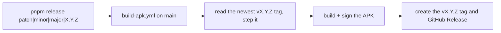

# Contributing

This is a Capacitor shell around a live site, not a bundled app: most of
what you'd change lives in the website itself, and this repo is mostly
native code for the one thing the web can't do — the offline Library.
`AGENTS.md` is the fuller reference; this is a map into it.

## Running it locally

```sh
pnpm install
pnpm sync              # cap sync android: copies capacitor.config.ts into the APK
pnpm android:build     # debug APK -> android/app/build/outputs/apk/debug/app-debug.apk
```

Building needs JDK 21 and an Android SDK with `platforms;android-36` and
`build-tools;36.0.0`. Gradle tasks should always be qualified with `:app:` —
an unqualified task also runs in the generated
`capacitor-cordova-android-plugins` module, which has no tests of its own
and fails a duplicate-class check on two old Kotlin stdlibs.

## Architecture map

| Path | What it is |
| --- | --- |
| `capacitor.config.ts` | `server.url`, the UA suffix, system-bar insets — the whole shell config |
| `android/app/src/main/java/me/hadoku/app/MainActivity.java` | The shell: logs the two startup probes, flushes cookies, owns Back, keeps the launcher as home, opens the Library offline or on its deep link |
| `android/app/src/main/java/me/hadoku/app/Theme.kt` | The Compose theme |
| `android/app/src/main/java/me/hadoku/app/Hadoku.kt` | Reads the session cookie at the moment it's needed; `online()` |
| `android/app/src/main/java/me/hadoku/app/web/` | `PageMediaPlugin` (a document-start script that reports whether the page is playing sound) and `PageMediaService` (the foreground service and media notification that keep the app alive while it does) |
| `android/app/src/main/java/me/hadoku/app/library/` | Library v1: catalog + episode parsing, `episode.json` records, DownloadManager orchestration, the Compose screens |
| `android/app/src/main/java/me/hadoku/app/download/EpisodeDownloads.kt` | Enqueues one file from watchparty's media route via DownloadManager |
| `android/app/src/main/java/me/hadoku/app/player/PlaybackService.kt` | The one player: a Media3 `MediaSessionService` — background audio, lock-screen controls, saved position |
| `android/app/src/main/java/me/hadoku/app/player/PlayerActivity.kt` | The screen that connects to `PlaybackService` |
| `android/app/src/test/` | JVM unit tests |
| `android/app/src/androidTest/` | Instrumented tests; `assets/episodes/fixture-s01e01` is a synthetic episode |
| `e2e/` | Playwright, driving the real WebView inside the installed debug APK |
| `scripts/` | `emulator.sh`, `release.mjs` (dispatches a release), `release-version.mjs` (computes one) |

Nothing a visitor sees is bundled: `www/` is one placeholder page that is
never actually shown, because `server.url` replaces it with the live site.

## Tests and gates

| Layer | Command | Runs where | What it proves |
| --- | --- | --- | --- |
| Typecheck | `pnpm typecheck` | CI | config + e2e suite compile |
| Unit (JVM) | `pnpm test:unit` | CI | episode layout and JSON parsing, the Library's records, the page's media report |
| Instrumented | `pnpm test:device` | emulator | playback, downloads, resume, background audio, system media keys |
| Shell e2e | `pnpm e2e` | emulator | launcher, bridge, UA, locked tiles, Back behaviour, the Home shortcut |
| Background audio e2e | `pnpm e2e:background` | emulator | a page's audio plays on for four minutes after Home and screen-off without the app being frozen; media keys pause and play it; muted media doesn't count |
| Signed-in e2e | `pnpm e2e:signed-in` | emulator, by hand | the session cookie reaches native code but not page JS |

CI (`build-apk.yml`) compiles the instrumented tests so they can't rot, but
doesn't run them on an emulator — that needs a runner with KVM, which the
fleet has not been asked for. Signed-in tests leave a real 30-day session in
production, so they never run unattended: without the right key they fail
loudly rather than skip.

## How it deploys

`build-apk.yml` is both the gate and the ship path: every push and PR builds
a debug APK. A release is a separate, manual act that edits nothing in the
repo — the version is computed at build time and only ever moves forward:



## Trivia

The versioning script refuses to compute a version at all when the minor or
patch number would reach 1000 — that's where its `major*1e6 + minor*1e3 +
patch` versionCode encoding would start colliding with the next major
(`scripts/release-version.mjs:35`, added in `f2c0d88`).
